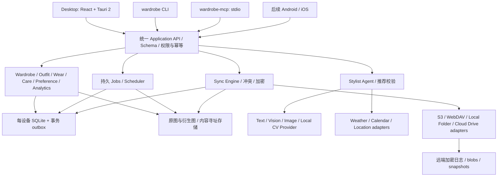

# wardrobe-agent 最终架构建议

设计草案 1.0，2026-10-06。这是面向完整目标的架构决策建议，尚未实现或完成跨平台原型验证。

## 1. 总体结构

采用模块化单体，共享 Rust 核心；入口和外部 provider 都是适配器。避免首版引入微服务与共享服务器数据库。



桌面前端只调用明确的 Tauri commands；CLI/MCP 链接同一核心库。MCP stdio 由宿主直接启动，无 GUI 依赖。首版不默认监听网络 HTTP 端口；若未来提供 HTTP，另加本地认证、来源限制与权限配置。

选择 Tauri 是安装包与本地集成的建议，不是已确认的性能结论。官方提供桌面/移动构建及分发路径，三平台产物仍需要各自构建、签名及系统验证：[官方分发文档](https://v2.tauri.app/distribute/)。

## 2. 模块边界

| 模块 | 职责 | 禁止承担 |
|---|---|---|
| protocol | 类型、输入/输出 schema、error、分页、版本、capabilities | 存储/UI/provider 逻辑 |
| core | 领域模型与约束、services、commands/queries、操作权限 | Tauri/CLI/MCP SDK 依赖 |
| db | migrations、事务、repositories、投影、outbox/inbox | UI 或 prompt 编排 |
| assets | CAS、导入预处理、资产来源、引用/回收 | 修改服装事实字段 |
| jobs | durable state、lease、重试/取消/进度、调度 | 重复计账、直接调用 UI |
| recommendation | 规则评分、组合校验、候选生成、解释因素 | 伪造库存或把推荐当穿着 |
| agent | tool loop、上下文预算、有限重试、模型结构化输出 | 直接 SQL 或任意文件/网络执行 |
| providers | 模型/天气/日历/通知适配、capability、限额、超时 | hardcode 单一供应商为业务模型 |
| sync | op 编码、因果/版本、冲突、应用、加密、设备管理 | S3 SDK、WebDAV URL、云盘 OAuth、远端 UI |
| storage adapters | list/get/put/stat、条件写/原子发布语义 | 领域合并策略 |
| apps/adapters | 界面、CLI flags、MCP tools/resources | 重复写业务规则 |

## 3. 数据模型

统一稳定 ID（推荐 UUIDv7；格式在协议层锁定），不能采用每设备自增主键作为同步身份。核心字段使用 canonical 枚举/ID，中文仅为展示文本。

| 实体 | 关键字段与规则 |
|---|---|
| Workspace / MemberProfile | 本地衣橱空间与主人，语言/时区/尺寸/偏好；无需登录即可使用 |
| ClientGrant | 本机 CLI/MCP 客户端的工具授权范围；不实现家庭协作者账号、邀请或协作角色 |
| Device | device_id、协议版本、公钥/配对信息、已知同步游标 |
| ClothingItem | member_id、分类/色系/材质/季节/状态、购买信息、主图引用、AI 结果审核状态、归档与删除信息 |
| ItemImage / ImageAsset | original、cutout、product、thumbnail、outfit、try_on；hash、mime、尺寸、来源/输入 ID、生成任务与 provider/model |
| Outfit / OutfitItem | 模板或方案；关联单品、顺序/层次/角色、场合、来源、图片；不要用 CSV 字符串外键 |
| Recommendation | 上下文快照、候选/选定 ID、理由、模型/规则版本；可独立于已保存搭配 |
| WearEvent | 稳定 event_id、实际日期/时区、单品/搭配快照、创建者；更正/撤销引用原事件 |
| CareEvent | 清洗/维护事件、日期、引用单品；待洗为从事件推导的状态 |
| FeedbackEvent | 对推荐/实际方案的接受/拒绝/舒适/风格/改穿记录；不会隐式产生 WearEvent |
| Preference | 用户显式偏好；保存来源与更新时间 |
| LearningProjection | 派生画像/配对分数、算法版本、event checkpoint，可重新计算 |
| AgentConversation / Memory | 可选保存同步；事实记忆可追溯，用户可编辑/删除 |
| Job / Schedule | 状态、输入、重试、取消、lease、时区、next_due、幂等 execution key |
| ChangeOp / Conflict / SyncCursor | 已提交领域变更、因果关系、冲突版本、设备水位 |

wearCount、lastWornAt、usage、pairScore 是投影，跨设备不能同步累加后的计数作为事实。将同一个 WearEvent 在两端应用两遍也只计一次；重算应得到同一结果。

## 4. 事务与多进程

所有用户可同步写入必须在同一 SQLite 事务中完成：领域实体/事件写入 + outbox op + 本地审计记录。远端同步回来的 op 经 inbox 去重后应用，不再次产生同一逻辑 outbox op。

SQLite 使用 WAL、foreign_keys、busy_timeout，写事务保持短；不把模型网络调用放在数据库事务里。GUI/CLI/MCP 可以同时存在，但迁移通过跨进程锁执行；任务由数据库 lease 原子 claim，一个 job 只由一个 worker 持有，崩溃后 lease 到期可接管。

Core 有版本化 migrations；旧客户端遇到不支持的协议/schema 操作应暂停并提示升级，不默默丢字段。上线前必须验证三入口并发、多进程迁移、写锁竞争。

## 5. 图片和模型任务

流程：先安全保存原图 → 建立 import draft → 本地预处理 → 可选识别/生成 → 结构化审核 → 提交实体/资产引用。AI 失败不丢原图，用户仍能手工录入。

资产内容以 SHA-256 标识；相同字节去重，不保证不同拍摄的同一衣服去重。pHash 可提示疑似重复，不能自动合并衣物实体。原图、商品图、搭配图、试穿图保留独立角色与 lineage。

任务状态：queued/running/waiting_input/succeeded/failed/cancelled。保存失败原因、可重试性、进度、provider request ID；不要记录完整 key/人体照片/敏感 request body。任务可取消并不意味着 provider 一定撤回已经计费的请求，UI 说明实际状态。

图片生成请求先校验最大输入张数、分辨率、同步/异步支持、模型可用性。需要生成任务能力，不只看是否“OpenAI compatible”。本地拼贴、背景去除、生成式商品图三种处理不混淆；试穿不承担真实尺码测量。

本地 CV 优先评估嵌入 ONNX runtime；若 Python 库不可替代，再用按平台打包的 sidecar，用户无需安装 Python。手机不依赖桌面 Python binary，需要平台 CV adapter。首次模型下载、大小、离线状态、权重许可独立呈现。

### 5.1 图片成本与同步策略（2026-10-07 用户明确要求）

- 原图存于导入设备的 local-only 资产区，保留原始文件；不进入同步 manifest、outbox、快照或远端迁移包。同步备份与包含原图的本地备份是独立选项，界面必须标清范围。
- 最终商品展示图是衣物跨设备展示的唯一图片来源；`display_asset_id` 指向用户最终采用的压缩版本。无需 AI 的图片也走方向归一化、合理缩放与编码压缩，成为最终展示资产，不复制大原图充当展示图。
- 同步层使用白名单：仅 `role=product_display && state=adopted && sync_scope=workspace` 的资产可上传。原图路径、源文件名、EXIF/GPS 和本地生成任务输入不进入同步数据；共享 lineage 只保留非敏感来源标记，原图关联保留在设备本地表。
- 新设备可以查看商品图、编辑资料与记录穿着，但不能恢复导入设备的原图。需要基于原图重新生成时，在拥有原图的设备操作或重新导入；不得创建永远等待同步的原图依赖。
- 缩略图由商品图在各设备本地重建；搭配可由商品图在本地确定性拼贴。生成式搭配/试穿结果不默认同步，后续改变策略需用户明确选择。

统一压缩流程：读取并归一化方向 → 校验尺寸/解码限制 → 选定展示图 → 按最长边等比缩小（不放大） → 去除非必要元数据 → 编码 → 检查体积与可见细节 → 本地预览/采用 → 同步。

建议初始参数（待样图验证，非已经冻结的质量承诺）：最长边 1600 px；无透明通道优先 WebP，兼容导出可用 JPEG；质量从约 82 开始，目标通常 150–400 KB，500 KB 为软阈值。超过阈值逐步调质量/尺寸，但设质量和尺寸下限；若图案、纹理或小字明显受损则允许超出软阈值并提示，不为满足文件大小损坏衣物细节。最终白底图通常无需透明 PNG；透明资产采用支持 alpha 的格式并单独评估。

压缩只作用于展示衍生图，不反复转码本地原图；已有小且合适的文件校验后可直接采用，避免越压越糊。先压缩再 hash/加密，使所有后端传输相同规范化字节。相同字节去重；替换展示图生成新版本，旧版本按引用、设备确认和回收策略释放，原图仍留本地。

需新增验收：无 AI/key 也能得到压缩展示图；所有同步 provider 拒绝 local-only 资产；同步快照/迁移没有原图；新设备无原图仍可使用；横竖方向、白色衣物、细纹/印花和大图压缩质量；压缩失败不上传原图兜底；对话附件与任务重试不会绕过白名单。

## 6. 同步协议

### 6.0 多后端与低耦合契约（用户明确要求）

S3-compatible 与 WebDAV 均为正式支持目标，本地文件夹为基础适配；其他主流云盘（例如 OneDrive、Dropbox、Google Drive）通过各自 API adapter 扩展。后者属于设计扩展目录，具体支持名单/顺序尚未冻结；不假设它们天然提供 S3/WebDAV。NAS 按实际暴露的协议接入，而不是按品牌另写同步引擎。

依赖方向固定为：**业务核心 → Sync Engine → SyncStorage 契约 ← 后端 adapter**。核心与同步引擎不得引用 AWS SDK、WebDAV client、云盘 OAuth 类型或供应商错误结构。adapter 不解释衣物、WearEvent、冲突或加密明文。加密、协议路径和同步状态由公共层统一管理。

统一最小接口草案（内部 Rust 类型，非最终 SDK）：

```rust
trait SyncStorage {
    async fn capabilities(&self) -> StorageCapabilities;
    async fn list(&self, prefix: ObjectKey, cursor: Option<Cursor>) -> Page<ObjectMeta>;
    async fn stat(&self, key: ObjectKey) -> Result<ObjectMeta, StorageError>;
    async fn get(&self, key: ObjectKey) -> Result<ByteStream, StorageError>;
    async fn put(&self, key: ObjectKey, data: ByteStream,
                 condition: WriteCondition) -> Result<ObjectMeta, StorageError>;
    async fn delete(&self, key: ObjectKey,
                    condition: DeleteCondition) -> Result<(), StorageError>;
}
```

`ObjectKey` 是不透明逻辑对象路径，云盘 file_id、S3 bucket/key、WebDAV URL 的映射由 adapter 管理。统一条件支持 any/create-only/match-version；不支持某项时明确 Unsupported，不能静默降级为覆盖。版本 token 不透明，**不能把 S3/WebDAV ETag 当成内容 hash**；内容完整性使用公共协议的 digest/AEAD。

| 能力 | 公共设计处理 |
|---|---|
| 分页/列表一致性 | 统一 cursor；游标失效可从头枚举且按 op_id 去重；不依赖供应商 listing 顺序 |
| 原子/条件发布 | capabilities 声明 atomic publication 与 conditional write；不可变对象 key + 校验 + commit marker；弱能力 backend 走明确降级策略或拒绝同步 |
| 大文件/续传 | 公共层负责逻辑对象与校验；adapter 封装 multipart/resumable 实现；能力可选，不泄漏 upload_id |
| 请求失败 | 归一为 Unauthorized/Forbidden/NotFound/PreconditionFailed/RateLimited/Transient/Corrupt/Unsupported；保留安全诊断，支持 retry-after |
| 删除/批量操作 | delete 必备，批量可选；由同步引擎决定何时 GC，adapter 不自行删历史 |
| 认证 | 配置与 secret 引用放 provider registry；token 刷新在认证服务，数据格式不存 key |

采用不可变日志段和 blobs 为基础，避免依赖跨对象事务、锁、rename 或原子追加。Local Folder 原子 rename 是优化，不能成为 S3 同步正确性的前提。commit marker 只在对象完整上传且校验通过后发布；弱列表一致性必须反复收敛，不凭“列表未出现”就推断远端删除。

配置由 `SyncTarget { target_id, provider_kind, namespace, config, secret_ref }` 管理，同步游标和能力缓存按 target_id 隔离。S3 adapter 支持 endpoint/region/bucket/prefix/path-style 等配置，具体兼容性按服务测试；云盘 adapter 管理专有根目录/file_id 映射。新增 adapter 不修改领域表结构、日志格式或合并规则。

用户可更换同步目标：先验证新后端能力与凭据 → 复制校验后的加密快照/日志/媒体 → 校验清单 → 切换目标，旧目标保留供回退。同一逻辑 op_id 和 workspace 不变；失败不抹掉旧游标。多个目标可配置，但首版推荐一个主同步目标，额外目标用于镜像备份；同时主动多目标双向同步属于额外协调能力，不能因接口可插拔就默认宣称实现。

所有 adapter 跑同一套 contract tests：分页、流式往返、条件写竞争、截断上传、超时/重试、重复请求、校验失败、凭据过期、大文件、删除与列举收敛。业务端跑相同同步场景并切换 backend，验证供应商替换不改变合并结果。


### 6.1 远端目录

```text
wardrobe-agent/<workspace-id>/
  protocol.json              # 协议/加密版本，不含明文衣橱资料
  devices/                   # 配对与设备状态
  changes/<device-id>/        # 已加密、不可变、分段日志
  blobs/<opaque-id-prefix>/   # 加密媒体
  snapshots/                 # 加密一致性快照与因果水位
  acknowledgements/          # 已处理水位，用于安全压缩/回收
```

WebDAV 只是文件传输；HTTP 条件请求/ETag 防止资源被意外覆盖，不自动合并业务数据：[RFC 4918](https://www.rfc-editor.org/info/rfc4918/)。每设备独立追加不可变段，避免全员争写一个总清单；Local Folder 采用临时文件 + 原子 rename 发布，忽略临时文件、不完整段与云盘冲突副本直至校验。远端目录列表可最终一致，下载后用 digest/MAC 校验。

### 6.2 ChangeOp

```json
{
  "protocol_version": 1,
  "op_id": "stable-uuid",
  "workspace_id": "workspace-id",
  "device_id": "device-id",
  "device_sequence": 42,
  "entity_type": "clothing",
  "entity_id": "item-id",
  "operation": "patch",
  "base_version": {"device-a": 18, "device-b": 7},
  "hlc": {"physical_ms": 0, "logical": 2},
  "patch": {"material": "cotton"},
  "asset_refs": [],
  "schema_version": 1
}
```

示例是加密前的内部 payload。HLC 提供排序，但并发检测还需因果版本/依赖与每字段 revision；单靠时间戳不能判断因果，更不能替用户决定真实颜色。

### 6.3 合并规则

- 不同字段并发修改：自动合并；同字段相同值：合并；同字段不同值：保留双方，进入 Conflict，用户选择或合并。
- 标签/集合：定义 observed-remove set 或等效操作式添加/删除规则；不能用整数组 LWW 使一方标签消失。
- OutfitItem 顺序/层次：以关系实体和版本处理；并发修改同一结构先呈现冲突，不盲目拼出无效组合。
- 穿着/洗护/反馈：追加稳定事件，按 event_id 去重；更正/撤销用新事件引用原事件。
- 删除：可恢复 tombstone 立即生效，迟到 update 不自动复活；删除与并发修改保留冲突副本；恢复是显式新操作。
- 缺图：实体先显示占位并继续排队拉取，不伪称已完整同步。跨端收到外键缺失时暂存依赖，不丢操作。
- 快照与清理：只有活跃设备确认水位、保留窗口与备份满足条件后压缩日志/回收 blobs。长期离线设备需要重新引导；不能仅按“30 天了”删除 tombstone。

### 6.4 E2EE

建议随机生成 workspace master key，用密码 KDF（例如 Argon2id）派生 wrapping key 封装主密钥，便于改密码时不重加密全部照片。按用途派生不同数据/元数据密钥；AEAD（例如 XChaCha20-Poly1305）加密日志与 blobs，版本化格式，唯一 nonce，认证 workspace/类型/版本等关联数据。具体库/参数待工程评估和审计，不能从聊天示例直接定为完成方案。

本地 plaintext 内容 hash 可用于去重，远端对象名使用由空间密钥产生的 opaque ID，避免暴露明文哈希与内容相同性给不同空间；密文仍会泄漏文件大小与时间等元数据，需要如实说明。

设计必须包含新设备配对、恢复码/恢复密钥、密码变更、撤销设备及密钥轮换。遗失所有解密凭据无法靠 WebDAV 密码恢复明文。API key/WebDAV 密码/平台 secret references 默认不参与同步。E2EE 保护同步服务器，云模型调用仍会收到用户主动发送的照片，两者不同。

## 7. 同步内容

默认同步衣物、搭配结构、事实事件、显式偏好与成员资料。图片仅同步最终采用且压缩后的商品展示图；原图、中间抠图、历史生成版本、搭配生成图、试穿图与真人参考照片均仅本地保存。聊天历史可选，不得借聊天附件绕过图片策略。学习投影优先本地从同步事实重算；需要同步的 Agent 记忆保存来源与版本。

不传缓存、缩略图缓存、模型文件、临时任务文件、日志与凭据。计划可同步定义，但执行设备要显式指定/lease 去重；设备路径、桌面通知授权与本地 worker lease 不同步。

## 8. 桌面调度与手机边界

### UI 设计与跨端边界（2026-10-07）

Beta 只交付桌面 UI；设计与审查使用 `hallmark`。视觉 tokens、组件语义和领域状态共同定义，导航壳、页面布局与平台输入能力各自适配。窄屏/触摸兼容在桌面开发期间验证，后续 Android 采用共享视觉语言与协议；技术路线经移动原型确定。详见 [UI 设计与跨端适配](04-UI设计与跨端适配.md)。


桌面任务需要运行的 App 或后台 helper；关闭所有进程/电脑关机无法准点计算。设置提供后台运行开关与开机启动选择，使用持久 due time，恢复后按用户选的窗口补执行，execution key 防重。

手机后续可用 Tauri 2 + 平台插件复用核心，也可 Swift/Kotlin UI 调 Rust API。需先原型验证摄像头、照片授权、安全存储、数据库文件访问、后台任务、通知与应用商店要求；不承诺桌面 sidecar、所有 UI 和后台行为原样移植。多设备不需要互相在线，只需能访问同一同步介质。

产品不做多人协作：不提供家庭邀请、共享角色、协作者权限或家人评价。同一用户的多设备通过设备配对共享空间密钥；独立成员档案属于该用户管理的数据分类，不宣称档案间具备多人隐私隔离。CLI/MCP 工具授权与设备配对仍保留。

## 9. 建议代码结构

```text
apps/desktop/                  # React UI + Tauri adapter
apps/mobile/                   # 后续，先留协议边界
packages/ui/                   # 共享组件，不重复领域模型
crates/wardrobe-protocol/
crates/wardrobe-core/
crates/wardrobe-db/
crates/wardrobe-assets/
crates/wardrobe-jobs/
crates/wardrobe-recommendation/
crates/wardrobe-agent/
crates/wardrobe-providers/
crates/wardrobe-sync/
crates/wardrobe-storage/         # 最小公共存储契约
crates/wardrobe-s3/
crates/wardrobe-webdav/
crates/wardrobe-folder/
crates/wardrobe-cli/
crates/wardrobe-mcp/
references/                    # 三个原始仓库，不直接修改
schemas/                       # Rust 导出的 JSON Schema/TS 类型
fixtures/                      # 同步和跨入口协议样例
```

不同时维护 packages/domain(TypeScript) 与 crates/core(Rust) 两份业务模型；从一份 schema 导出类型。模块数量可先用少量 crate + 内部模块实现，接口稳定后拆分，避免仅为目录美观过早拆包。

## 10. 分阶段交付与验证

1. **规格冻结**：三个项目完整功能矩阵、领域 schema、三入口契约、同步/删除 ADR、许可证清单。
2. **核心闭环**：手工录入→搭配→WearEvent→洗护→分析，GUI/CLI/MCP 一致；备份、原图、回收站和任务队列。
3. **同步原型**：先 Local Folder 双设备，再 S3-compatible / WebDAV、E2EE、设备配对、冲突与恢复；同时准备手机协议 fixture。
4. **AI 完整能力**：识别、推荐/反馈、商品图/搭配图/试穿、内置工具 Agent、外部写回、可靠 provider。
5. **Wardrowbe 基线补齐**：独立成员档案、Lookbook/配对、多图、计划/通知、全部筛选/分析/设置以及原始功能矩阵验收。
6. **三平台发行与手机**：EXE/DMG/DEB clean install/upgrade/restore；随后手机原型及移动端完整实现。

必须验证：两设备并发同字段/不同字段/删改冲突、时钟偏差、离线反复同步、重复/乱序 op、缺 blob、日志截断、进程崩溃、密钥错误/轮换、迁移失败、休眠恢复；推荐 ID 不存在/不属成员/洗护不可用；重试不重复记穿着；保存搭配不改变穿着统计。验收最终是运行结果，当前静态研究没有声称这些检查通过。
